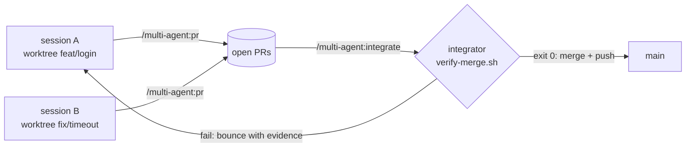

# claude-code-multi-agent

[](https://github.com/R0drig0V1/claude-code-multi-agent/actions/workflows/ci.yml)
[](LICENSE)
[](https://code.claude.com/docs/en/plugins/overview)

A [Claude Code](https://code.claude.com) plugin for running **several Claude sessions in
parallel on one repository** without them stepping on each other or on `main`.

- **One integrator owns `main`.** It verifies each pull request merged onto `main`, merges the
  green ones and bounces the rest with evidence. It acts as an adversarial auditor, not a
  helper.
- **Every other session works in its own git worktree** and branch, and finishes with a pull
  request.
- **Hooks enforce it.** Edits, commits, dependency installs and pushes to `main` from a
  non-integrator session are blocked before they run.
- **Sound + terminal bell** tell you which tab finished or needs attention (macOS, Linux,
  Windows).



## Install

### Plugin + project files (recommended)

From inside the repository you want to set up:

```bash
curl -fsSL https://raw.githubusercontent.com/R0drig0V1/claude-code-multi-agent/main/install.sh | bash
```

The installer copies the project-owned files and never overwrites existing ones
(`--dry-run` previews, `--force` overwrites). It also enables the plugin in
`.claude/settings.json`, so teammates get it when they trust the folder. Commit the result
on `main`.

### Plugin only

```
/plugin install multi-agent --marketplace R0drig0V1/claude-code-multi-agent
```

or, on older Claude Code versions:

```
/plugin marketplace add R0drig0V1/claude-code-multi-agent
/plugin install multi-agent@claude-code-multi-agent
```

The guard hooks only act in repositories whose `.claude/settings.json` (or
`settings.local.json`) enables `multi-agent@claude-code-multi-agent`. A user-scope install
therefore leaves your other repositories alone and only adds the notifications there.

## Usage

| Who | How |
|-----|-----|
| Integrator | `scripts/integrator.sh` in the main checkout, then `/multi-agent:integrate` |
| Developer session | `/multi-agent:worktree feat/<name>`, work, `/multi-agent:commit`, `/multi-agent:pr` |
| Before a phase | `/multi-agent:improve-plan` (red-team review of `docs/phases/`) |

A session opened in the main checkout is told by the `SessionStart` hook to create its own
worktree from the first request that needs changes.

## What's inside

| Component | Name | What it does |
|-----------|------|--------------|
| Skill | `worktree` | Creates `../<repo>-<name>` on a new branch from `origin/main` and switches the session into it |
| Skill | `commit` | Conventional Commits in English, runs `scripts/check.sh` first, never stages secrets |
| Skill | `pr` | Rebases, checks, opens the PR with a structured body, messages the integrator |
| Skill | `integrate` | Integrator loop: queue → merge `--no-commit` → `verify-merge.sh` → merge or bounce → update plan |
| Skill | `document` | Brings docstrings, `docs/`, ADRs and `CLAUDE.md` up to date |
| Skill | `improve-plan` | Up to 3 adversarial rounds against `docs/phases/` with `plan-adversary` |
| Agent | `plan-adversary` | Read-only red-team reviewer of the plan |
| Agent | `code-reviewer` | Read-only bug and security reviewer |
| Hook | `guard-main-worktree.sh` | Blocks Edit/Write in the main worktree |
| Hook | `guard-main-bash.py` | Blocks shell writes, mutating git, dependency changes and formatters in the main worktree, plus `gh pr merge` and pushes to `main` |
| Hook | `session-start-worktree.sh` | Tells sessions in the main worktree to move to a worktree |
| Hook | `notify.sh` | Sound and terminal bell on Stop / Notification |
| Script | `new-worktree.sh`, `verify-merge.sh` | Worktree creation; verification gate whose exit code is the verdict |

Project-owned files from `template/`:

| File | Purpose |
|------|---------|
| `CLAUDE.md` | Rules and workflow for the agents, with `TODO`s for your project |
| `scripts/check.sh` | **Your** lint/type/test commands: the single definition of "green" |
| `scripts/integrator.sh` | Launches the integrator (`CLAUDE_ROLE=integrator`, session name `integrator`, auditor prompt) |
| `.claude/prompts/integrator.md` | The integrator's adversarial-auditor stance |
| `.claude/settings.json` | Enables the marketplace and the plugin for the project |
| `docs/{phases,decisions,plan-reviews}/` | Plan, ADRs and plan reviews |

## Configuration

| What | How |
|------|-----|
| Checks | Edit `scripts/check.sh` (formatters in check mode: it runs in the main worktree) |
| Per-worktree setup | Optional `scripts/worktree-setup.sh <branch>`: install deps, create a private test DB… |
| Integrator state reset | Optional `scripts/verify-reset.sh`: recreate shared test state before each verification |
| Mute notifications | `CLAUDE_NOTIFY_SOUND=0` and/or `CLAUDE_NOTIFY_BELL=0` |

## Requirements

`git`, `bash`, `jq`, `python3` (3.9+) and the GitHub CLI `gh` (for PRs). On Windows, Claude
Code runs hooks in Git Bash. Sounds use `afplay` (macOS), `paplay`/`aplay`/`canberra-gtk-play`
(Linux) or `powershell.exe` (Windows, WSL).

## Limitations

- The guards are **guardrails, not a sandbox**. They parse commands with `shlex`, and a
  deliberately creative command can get past them. They fail open: if `python3` or `jq` is
  missing, or the hook errors, the command is allowed.
- The integrator is recognised only by `CLAUDE_ROLE=integrator`.
- `verify-merge.sh` is only as strong as your `scripts/check.sh`.

## Development

```bash
tests/test-hooks.sh                 # hook + installer smoke tests
claude plugin validate plugin && claude plugin validate .
```

## License

[MIT](LICENSE)
